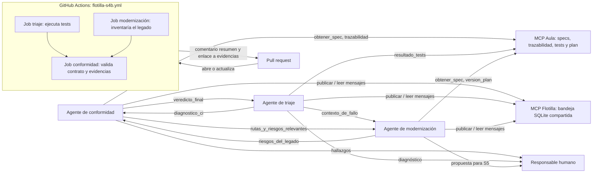

# Flotilla multiagente de Aula

## Componentes

- **MCP Aula** ofrece specs, trazabilidad, resultados de tests y datos del plan.
- **MCP Flotilla** entrega mensajes entre los tres agentes usando SQLite.
- **GitHub Actions** ejecuta las comprobaciones del pipeline y publica un resumen automático en el pull request.
- **Conformidad** revisa un PR frente a su spec.
- **Triaje** analiza los logs de CI e intenta reproducir fallos.
- **Modernización** analiza el legado en modo de solo lectura y propone trabajo para S5.
- **Responsable humano** revisa las salidas y decide qué integrar.

## Diagrama

El workflow hace comprobaciones automáticas; no inicia sesiones de IA. El
comentario del pull request resume el resultado de los jobs y enlaza sus
evidencias. Los agentes siguen intercambiando sus análisis mediante MCP
Flotilla, y una persona conserva la decisión final.
